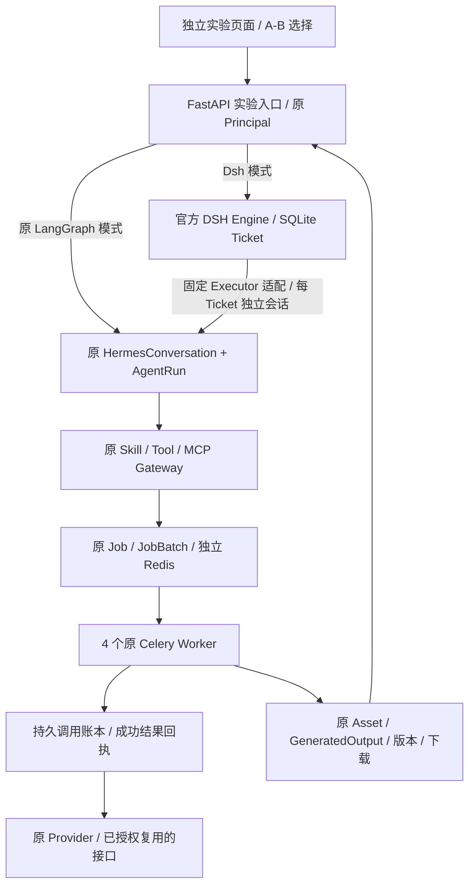

# DSH 实验盘点与接入边界

> 原生 Session 迁移后的架构与验收见 [NATIVE_MIGRATION.md](NATIVE_MIGRATION.md)。本文件以下保留第一阶段盘点历史，包含当时仍调用 LangGraph 规划器的旧 Adapter，不代表当前 DSH 主路径。

日期：2026-11-06，北京时间。原工作目录 `C:\Users\Woda\Documents\AI生图`。

原分支为 `codex/agent-control-v2`，起点 `b838c7cf80db2d46665375ba29dda7b836163d6a`。盘点时有 79 个已跟踪文件发生变化、382 个未跟踪路径；其中 214 个未跟踪源码/配置/测试/素材文件随 79 个改动复制到独立 Worktree，形成快照提交 `502d3601073bbbee0c963215b01c5cb48f2f0246`。未使用 stash、reset、restore，也未切换或提交原工作目录。未复制原 `.env`、诊断目录、虚拟环境或生产数据。

隔离目录为 `C:\Users\Woda\Documents\AI生图-dsh-superagent`。检查到的远程为 `origin=https://github.com/samoyelyh/amazon-image-studio.git`、`upstream=https://github.com/Ali-Aria/amazon-image-studio.git`。没有推送或合并。

## 现有平台盘点

| 部分 | 实际实现 | 实验处理 |
|---|---|---|
| LangGraph 主控/路由 | `server/app/agents/runtime.py`、`graphs/supervisor.py`、`capabilities/orchestrator.py`、`light_router.py`。AgentRun、事件、确认快照及 MySQL/测试 SQLite Checkpointer | 保留。DSH 管理 Ticket 生命周期，原规划器继续选择 Skill 和业务动作 |
| 对话/任务归属 | HermesConversation / HermesMessage、AgentRun、pending_actions、reply_to_run_id、creative_module、start_new_task、parent_output_id | DSH Main Session 持久保存焦点 Ticket；每个 Ticket 有独立的原生 Hermes 会话。普通聊天独立回答，可只读引用焦点任务上下文 |
| Skill / Tool / MCP | CapabilityRegistry 动态目录、JSON Schema、权限与审批快照、MCPGateway。三个目标 Skill 均已存在 | 直接复用 `amazon-market-insight`、`amazon-aplus-planner`、`image-creation`。未接入通用 Shell 或任意 URL 工具 |
| ASIN 调研 | `amazon_research.py` 用 HermesToolAudit 先落库，再请求获准 MCP；按用户、参数、Schema 去重；费用未知时保留 unknown | 保留真实回执与未知状态。实验审批文件单独匹配实验账号；实时 Schema 只移除了不再支持的 SA 站点 |
| A+ / Listing | `amazon.py`、`amazon_brief.py`、`aplus_design.py`、原 Skill、Prompt Composer。稳定模块 ID、商品证据、方案审核与模块签名 | 保留。新增的人类事实确认同时进入门禁记录和原生 user 消息历史，模型不能填写此确认 |
| Job / Worker / 并发 | 原 Job / JobBatch、ResourcePool、ResourcePoolKey、Redis lease、Celery 队列、`workers/tasks/jobs.py` | 原代码继续执行。4 个独立 solo Worker 进程；单批次并发仍由原 JobBatch.concurrency 和资源容量控制 |
| 版本/恢复/下载 | GeneratedOutput 的 root/parent/version、Asset、JobAttempt、AgentJobLink、原图片下载和 Amazon ZIP 服务 | 保留。Worker 外加持久调用账本和成功结果回执；未知付费状态不自动重发 |
| DB / Redis / 权限 | 原生产 MySQL、Redis、JWT Principal、组织/成员/权限、账号级资产访问 | 生产不改。实验 SQLite、独立 JWT 密钥/issuer/audience/刷新 Cookie；独立 Redis DB 0/1/2；原 Principal 和资产所有权校验继续生效 |
| 前端 | `/workspaces/agent-control`，`AgentControlWorkspace.tsx`、专业卡片、素材导入、提示词/图片版本、轮询恢复 | 原前端不改。实验仅增加独立 `/experiment` 页面，提供 A/B 选择、任务焦点、事实确认、图片/ZIP 下载 |

## 官方原型的实际接口与限制

源码固定为 [deepseek-ai/dsh-superagent-prototype](https://github.com/deepseek-ai/dsh-superagent-prototype) 的 `8c32a9dc5d72c033816c6a8110b37f40cf94fba4`。已读取 `docs/001-domain.md`、`002-authorization.md`、`003-execution.md`、`007-architecture.md`，并核对执行代码与部署文档。原型使用 MIT 许可证。

官方包不是 FastAPI 服务或现成的多用户生图 Agent API。入口 `src/index.ts` 是 Cordis / DeepSeek Harness 插件，注入 `agents`、`sessionController`、`sessionPersistence`、`permissionPresets`、`tools`、`webServer`、`llm`、`subprocess` 等服务。它的 Sources 是 GitHub/飞书；默认 DshExecutor 创建编码 Session 和工作目录，能够以 OS 用户执行命令。部署检查要求 GitHub 仓库与账户。其本机管理 API 没有平台的组织/账号权限模型。

实际安装使用 Node 24.14.0、上游声明的 pnpm 11.7.0、官方 CLI `@deepseek-ai/dsh@0.2.1-rc.3`；包 Peer Dependencies 固定到大量 `@deepseek-ai/dsh-* 0.2.1-alpha.2` 组件。依赖安装、typecheck、build 成功。Windows 上上游测试为 1155 通过、42 失败、17 个未处理错误，失败包括 `sh`/`sleep`/tmux 等 POSIX 假设、路径和文件权限语义；不是全绿的 Windows 运行基线。

完整 Harness / Superagent 插件的管理 API 实测 HTTP 200，但运行状态为 `setupPending`，原因是 `repositoryUnset`。为核实启动采用了 Windows 可识别的 `/Users/...` rooted 路径，因为其 stateDir Schema 拒绝 `C:/...`。未配置 GitHub/飞书来源，未赋予官方编码 Executor 系统工具或生产凭据；启动探针完成后已停止该 Harness。

可直接复用的是 `src/core` 的同步领域 Engine 及 Repositories、Policy、Assessor、Executor、Outbox 端口。实验将官方核心原样纳入 `experiments/dsh/upstream`，包括许可证、四份文档和逐文件哈希 `PROVENANCE.json`。没有改写 Ticket、Mandate、Subscription、Assignment、resume/stop 的官方领域实现。

## 本次最小适配

Main Session 是平台 Adapter 的持久路由状态，Executor 是固定的原平台调用路径；不是运行在官方 Harness 内的 Main/Executor LLM Session。语义规划依然由原 LangGraph 完成。这个实验能检验 Ticket 管理是否改善工程行为，不能证明官方完整智能体优于 LangGraph。

平台入口从服务端 Principal 提取组织/用户，客户端不能提供它们。内部 Sidecar 仅监听 `127.0.0.1:18871`，使用独立随机令牌，不接受系统命令、数据库 URL 或 Provider 参数。每条 Trigger、焦点和请求回执按组织/用户/Main Session 隔离；每个 Ticket 绑定一个不可变的原会话。后续修改走目标 Ticket 的 Subscription；新工作用新 Ticket。自动关联使用保守规则与焦点状态，复杂歧义仍需选中目标任务，没有验证通用语义归属能力。

`SqliteRepositories` 为官方 Repositories 端口提供同步事务持久化。领域端口的 start/deliver/stop 只持久排队并反馈状态，不执行 OS 命令。API 负责原会话和 Run 的幂等映射；异步收费调用留在原 Worker。运行中的 Assignment 在 Sidecar 重启后通过官方 `assignmentInterrupted` 恢复。

预算账本位于 Worker 私有状态目录，按 Job ID 先占用，再发 Provider 请求，跨进程和重启共享；每类最多 50 次。成功 ProviderResult 留存供同 Job 重放；失败/未知请求不会自动补发。MCP 仅缓存真实回执，实际 `tools/call` 单独计数，预检查失败不冒充真实查询。原模块签名、Job 幂等键和 unknown 防重规则继续存在。

已授权复用的接口由受信任的生产侧只读探针选择启用的 Provider/Model/Key，Key 在该进程内重新加密给实验 Worker。探针只读事务不修改生产。DSH Sidecar 不接收 Key、生产数据库连接或原 `.env`。本地 Worker 与 API 的私有配置保存在忽略目录 `.state`，未进入 Git。当前隔离属于固定代码与工具接口边界，并不代表已完成面对恶意原生插件的 OS 沙箱验收。

## 目录和改动清单

本次实现仅在实验 Worktree 新增下列内容；快照提交之后没有改动原生产入口、原主控、原 Worker 或生图引擎源码。

| 新增路径 | 用途 |
|---|---|
| `experiments/dsh/upstream/` | 原样官方核心、许可证、文档、来源哈希 |
| `experiments/dsh/controller.ts` | Source / Policy / Executor 端口、所有权、焦点与领域回执 |
| `experiments/dsh/repositories.ts` | 官方 Repositories 的 SQLite Adapter |
| `experiments/dsh/sidecar.ts` | 本机认证 HTTP 边界 |
| `server/app/experiments/dsh/api.py` | 实验 API、原 Run 接入、普通聊天隔离、事实确认、恢复调度 |
| `server/app/experiments/dsh/ledger.py` | 付费调用上限、成功回执、未知状态防重 |
| `server/app/experiments/dsh/bootstrap.py` | 隔离 Schema/RBAC/额度与获授权模型配置 |
| `server/app/experiments/dsh/environment.py` | 明确的测试配置与 DB/Broker 限定 |
| `server/app/experiments/dsh/storage.py` | 原 StorageService 的本地实验对象存储 Adapter |
| `server/app/experiments/dsh/worker.py` | 原 Celery Worker 的实验启动装配 |
| `experiments/dsh/index.html` | 独立实验界面、A/B、任务恢复、素材与事实、下载 |
| `experiments/dsh/start.ps1` / `stop.ps1` | 命名进程、端口、活跃任务检查、控制器单独重启 |
| `experiments/dsh/verify_live.py` / `verify_isolation.py` / `verify_recovery.py` / `verify_aplus_delivery.py` | 有界真实调用、权限与文件、运行中恢复、模块范围与 ZIP 验证 |
| `experiments/dsh/collect_evidence.py` | 白名单导出测试指标，排除私有配置 |
| `experiments/dsh/controller.test.ts` / `server/tests/test_dsh_experiment.py` | 核心与 Adapter 回归，包括真实 Node/SQLite HTTP 接入测试 |
| `docs/dsh/` | 盘点、结论、测量和真实图片样本 |

遗留未验收项与实时统计见本目录 README 和 `evidence/measurements.json`。原分支没有自动合并、推送或部署。
