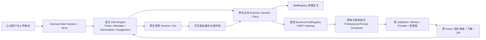

# DSH 原生主控迁移：真实验收与切换限制

2026-11-06，北京时间。分支 `experiment/dsh-superagent`，目录 `C:\Users\Woda\Documents\AI生图-dsh-superagent`。本次基于已有实验提交 `7a2176dc54070c15456467fdeaf5f8472fddad92` 继续开发，未重做第一阶段架构盘点。

**DSH 已独立完成真实商品的整套 A+、并发生图、图片交付及第三模块修改；尚未完成 18080 正式替换。** 原 LangGraph 规划器已退出 DSH 路径，但当前延迟、竞品 MCP 数据验收、视觉质量以及原 React 前端兼容尚未达到默认切换标准。18080 仍使用原主控。不能把这次成果称为生产迁移完成。

## 运行实现和边界

使用官方 Harness `0.2.1-rc.3` 的 Cordis、Agent Registry、Agent Loop、Session、System Prompt、Tools 和 JSONL Persistence。官方 DSH Engine 核心仍固定在 `8c32a9dc5d72c033816c6a8110b37f40cf94fba4`，未重写其领域核心。依赖已锁定在 `experiments/dsh/native-runtime-package*.json`。

这里组合真实 Harness 内核与业务 Session。官方原型的 GitHub 编码应用、仓库设置和 Shell Executor 没有启用。没有把一个自写 HTTP 模型循环冒充 Harness Session；`native-runtime.mjs` 中真实 `ctx.agents.create/resume`、`agent.followup/whenIdle` 及官方 Agent Loop 负责模型请求、工具分派和持久化事件。



Main 通过真实模型的 `route_task` 调用选择聊天、澄清、任务、继续、进度或停止，以及专业 Executor 类型。DSH 分支入口不再调用旧关键词 `classify`。普通聊天的 Session 只看到调度工具，不能直接生成图片。显式 UI 的查询/停止操作无需付费模型。

专业 Executor 的系统提示及输入绑定 SkillRegistry 返回的完整 Skill 正文、版本和内容哈希，随后由模型自行决定商品选款、事实、模块规格、构图、光线和文案。`produce_aplus` / `produce_listing` 仅把模型写出的简报交给原方案服务和并发生成服务，不包含旧的语义规划器。

DSH 路径没有调用 `plan_intent`、`build_chat_plan` 或 `build_dynamic_plan`。`native.py` 直接调用获准的业务动作；原 `runtime.conversation` 仅用于权限/所有权查询。DSH 会话的 `controller_type='dsh'`，执行记录的 `graph_version='dsh-native-v1'`、`planner_mode='dsh-native'`。旧 `reconcile` 和 `auto_execution.drive` 对 DSH 记录直接返回，旧 `advance` 的版本检查也不会接受 DSH 记录。

Engine 的 Assignment 在真实 Harness Session 发布后才通过 `sessionStarted` 确认启动，持久化绑定 Session 和 Assignment。重启产生官方 interruption/recovery Input；新的 Assignment 使用独立执行 Session，从已持久化商品事实、方案、输出和用户消息恢复。Main 释放调度后，不同 Ticket 可独立执行；同一 Ticket 的连续修改排队，避免覆盖执行上下文。

## 复用和安全控制

- 复用 `amazon-aplus-planner`、`amazon-market-insight`、`image-creation`，以及原 SkillRegistry / BusinessToolRegistry。
- 复用原卖家精灵 MCP Gateway、审批清单和真实输入 Schema；没有把连接失败替换成虚构竞品资料。
- 复用 Professional Prompt Composer、Amazon 规格/槽位校验、JobBatch、Worker、Provider、资源池与并发控制。
- 复用 Asset、GeneratedOutput、模块版本、原下载和 ZIP；ZIP 保留版本历史。
- 每次业务工具调用重新解析用户权限；所有任务、上下文、素材和输出均按组织及用户校验。DSH 素材使用现有 `private_scope=agent_chat`，原隐私查询补充识别 DSH controller。
- 没有向 Session 注册 Shell、任意文件系统、SQL、通用 HTTP 或生产凭据工具。Node/Python 服务只有受信代码访问各自运行状态。
- 原 Provider 流式传输保留，新增完整 tool call 分片收集；截断、524、超时和未知结果不会触发第二次付费请求。
- Worker 在外发前持久化调用保留记录，成功后先保存真实 Provider 回执，再结算平台 Job。只有已知成功回执可零请求重放；未知结果禁止重发。MCP 只有明确 `actual_requests=0` 的失败预检允许一次重试，历史记录保留。

## 实际商品与完整结果

使用用户提供的 `Desktop\11.4\主图` 和 `Desktop\11.4\模板`。真实视觉 Session 自主选择 Seattle，记录深蓝至深青渐变、正面 Seattle 图案、背面 `YOUR NAME / 00` 等可见信息。材质、性能、定制服务和授权列为未知，未作为商品承诺。

| 场景 | 实际结果 |
|---|---|
| 普通问答 | 真实 Terra 调用 1 次；无 Ticket、无图片 Job |
| “帮我做一套图” | 真实 Terra 调用 1 次；询问 A+ 或 Listing，没有生成 |
| 第一套真实 A+ | 5 模块、8 张独立图片，全部成功 |
| 同素材 A/B 的 DSH | 5 模块、8 张独立图片，全部成功 |
| 第三模块局部修改 | 同一 Ticket、同一会话；仅新增 1 个 m3 Job，图片版本 2 |
| Listing | 独立 Listing 能力；3 张 1600×1600 图片，全部成功 |
| 竞品研究 | 原生模型确实选择和调用 MCP；一次真实工具请求超时，计费状态未知，未取得可用竞品资料 |
| 另一用户/另一组织 | 任务、素材、输出、ZIP、指定 Ticket 和素材引用均返回 404 |
| 浏览器恢复 | 实际浏览器登录后恢复 A/B 任务，显示 8/8 图片并提供 ZIP；截图见证据目录 |

两套 A+ 均包含横幅、单图文、三图文和侧栏等布局，8 个图片槽位分别生成；尺寸包括 970×600、600×600、600×800、600×350。并发峰值为 4 个真实 Provider 请求。没有用两张合成测试图冒充本次商品验收。

局部修改校验：原 8 个输出仍存在，所有文件 SHA-256 与创建时记录一致；其他模块的完整方案对象未改变，第三模块文案也未改变。新增版本显示室内更衣室和背面商品。多槽位模块的单槽精确修改仍需补齐验证，目前轻量视觉修改接口拒绝模糊多槽修改。

交付文件位于：

- `.state/native-delivery/Seattle-Aplus-native.zip`：第一套 A+，含局部修改及原服务保留的版本历史。
- `.state/native-ab-delivery/Seattle-Aplus-native.zip`：同素材 A/B 场景的完整 DSH 套图。
- `.state/native-delivery/manifest.json`、`.state/native-ab-delivery/manifest.json`：图片、Job、Output、模块、尺寸、哈希。
- `.state/native-listing-v1.json`：Listing 的完整任务及输出记录。

## 实测模型、速度和费用

模型名称均是现有中转资源池的请求别名，不代表能独立核验供应商内部实际模型身份。

| 阶段/指标 | 实际测量 |
|---|---|
| A/B 场景 Main | Terra，1 次，调用 18.035 秒；调度阶段 19.876 秒 |
| A/B 商品视觉 | Sol，1 次，39.103 秒 |
| A/B Executor 选研究工具 | Terra，1 次，17.441 秒 |
| A/B Executor 完整策划/提交 | Terra，1 次，136.055 秒 |
| DSH 提交整套图前的墙钟时间 | 297.331 秒，含排队、MCP 失败和调度 |
| 8 张图片 Provider 阶段 | 68.403 秒，峰值并发 4 |
| 该 DSH 场景已知文本 Token | 41,848，4 次真实模型调用 |
| 同场景 LangGraph | Terra 29.331 秒 + Sol 97.107 秒；26,109 个已知 Token；停在 `agent.research_unverified`，无图片 |

A/B 与局部修改同时运行，共用同一组隔离资源池，时间包括资源争用；这不是空载单任务基准。LangGraph 未完成整套业务，不能据此宣称 DSH 在完成速度、成本或视觉质量上优于它。只有一个代表性对照场景，不能当作统计成功率。

Sol 在带大量工具/上下文的早期专业 Session 请求中出现两次超时。当前实测分工为 Terra Main/业务策划、Sol 独立视觉分析。专业策划仍偏慢，尚未满足“不明显增加等待”的性能验收。

累计保留原实验预算：文本 **50/50**、图片 **28/50**、MCP 保留记录 **3/50**（另有零请求失败预检）。其中旧实验已有文本 19、图片 8；本次新增真实商品图片 20。已知累计 Token 为 587,672，包含旧实验及失败前的成功调用，不是单套 A+ 成本。中转没有返回货币金额，API 金额保持未知；失败/未知调用缺少 Token 回执，没有按 0 费用处理。

## 恢复测试中发现并修复的问题

1. 大型连续转录超过 Job 128 KiB 入参上限：使用有 512 KiB 解压上限的压缩转录，保留原 Job 限制；连续对话只补充变化，Assignment 分离 Session。
2. SQLite 不支持原 MySQL 行锁：并发额度结算丢失冻结值，导致一个已付费成功的文本 Job 卡住。先备份实验库，再由不可变额度流水核对冻结值，从 0 恢复为 10；通过原 Worker 的已保存成功回执完成结算，新增 Provider 请求为 0。
3. 对实验 SQLite 的额度账户读取至提交增加进程间锁，10 路并发测试确认无丢失更新。锁只作用于指定实验数据库，Provider I/O 前已有提交边界，图片生成仍并发。正式部署仍应使用原 MySQL；本机文件锁不是多主机方案。
4. 原生恢复只能重放同一用户、同一不可变请求中已知成功的模型工具决策；日志明确标识 `replayed_from_job`。未知结果不在此路径内。Listing 最终使用该真实成功决策完成 3 个图片 Job，没有再次付费请求模型。
5. Windows 系统代理为本机 7897。实验 MCP 客户端支持显式本机代理，工具发现成功；真实工具调用仍出现上游超时。一次已经到 `tool_call` 的请求没有重试。

## 未通过项与 18080

当前 `production_cutover_ready=false`，**没有修改或部署 18080，也没有把生产数据库接给 DSH**。实验页可通过主控下拉框选择 DSH 或原 LangGraph；这就是本次可用的 A/B/回退方式。

18080 的默认切换、原 React Agent 页对 DSH 的完整兼容以及切回 LangGraph 的部署开关尚未交付。不得把实验 HTML 页面当作已经替换生产前端。按照本任务的切换条件，需要先解决以下问题，再完成该集成和切换：

- 卖家精灵实际返回可用 ASIN 资料；当前请求已知发出但结果/费用未知，需要核对回执，不能自动重发。
- 降低多阶段规划和工具/上下文带来的延迟；目前观察到约五分钟规划等待。
- 专业视觉验收：画面已有不同布局、比例和人物场景，但若干正面细节图仍重复，文字和图案是生成式近似，尚未证明逐像素保真。
- 多槽模块单图片修改、独立通用图片编辑和完整批量换衣专业流程尚未完成真实验收；不能宣称所有业务已经覆盖。
- 在独立 MySQL 环境完成并发与恢复复测，随后接入原 React 前端和可回退的默认主控开关。

结论：**值得保留原生 DSH 实验继续开发；目前不值得直接作为 18080 默认主控。** 真正的模型决策接管已有运行证据，正式迁移仍需以上验收和集成工作。

## 文件和复验

关键新增文件：`native-runtime.mjs`（真实 Harness 内核）、`native-controller.mjs`（Main/Executor 调度）、`native.py`（受控业务边界）、`quota_lock.py`（实验 SQLite 结算锁）。`controller.ts` 接入真实 Session 启动确认；`sidecar.ts` 提供原生路由；`openai_compatible.py` 保留工具转录和流式分片。原权限查询增加 DSH 类型识别，旧自动执行入口跳过 DSH 记录。

入口 `http://127.0.0.1:18870/experiment`；实验账号在 `.state/login.json`。同一会话选择“恢复选中任务”，可查看已完成结果；刷新登录通过原隔离 refresh cookie 恢复。内部端口 18871 需要私有令牌，Redis 为 16489。原生产端口、Git 分支、数据库和原始图片未修改。

自动检查：38 项 Python 测试、9 项 Node 测试通过。原生 Kernel 单元测试使用受控假模型测试协议；上述商品、模型、MCP、生成和下载证据来自真实调用，两者明确分开。

```powershell
# 只读复核，不发模型或生图请求
& ..\AI生图\server\.venv\Scripts\python.exe -X utf8 experiments/dsh/verify_native_acceptance.py
& ..\AI生图\server\.venv\Scripts\python.exe -X utf8 experiments/dsh/collect_native_metrics.py
```

审阅证据：`evidence/native/measurements.json`、套图预览和浏览器截图。完整私有日志：`.state/core/native/native-events.jsonl`、原生 Session JSONL、`.state/native-gateway.sqlite`、`.state/platform.sqlite`、`.state/worker/budget.sqlite` 和成功回执。凭据、数据库、原始商品图及完整日志未提交 Git。

官方参考：[SuperAgent 原型](https://github.com/deepseek-ai/dsh-superagent-prototype)、[DeepSeek Harness](https://github.com/deepseek-ai/deepseek-harness)。
