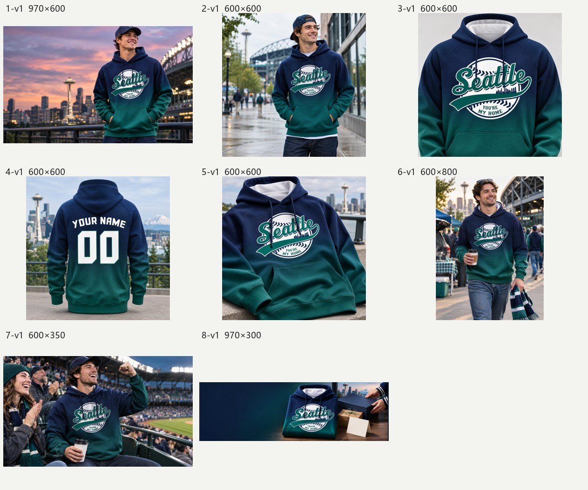
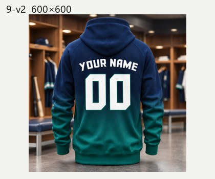
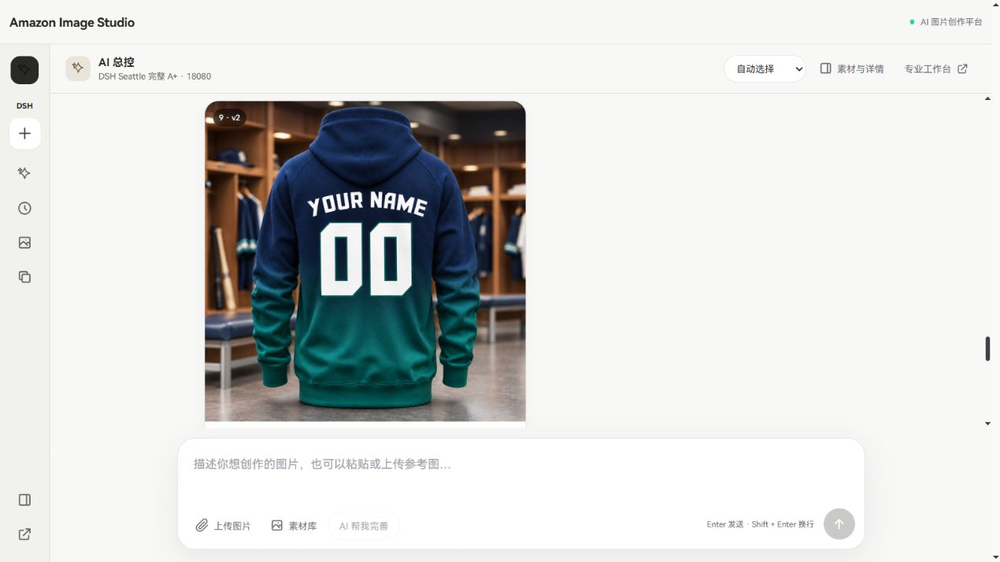

# 18080 DSH 正式接入交付

2026-11-06，北京时间。分支 `experiment/dsh-superagent`，提交 SHA 见交付消息及本分支 HEAD。

## 当前入口与主控

正式入口为 http://127.0.0.1:18080/workspaces/agent-control ，使用现有 React 页面、登录与 FastAPI `/agent` 接口。默认主控已设为 **DSH**，不是独立实验 HTML 页面。Main、Vision、Executor 均配置 `kimi-for-coding`、`reasoning_effort=low`，沿用用户要求的 [K2.8 配置](https://www.kimi.com/code/docs/kimi-code/models.html)。生图仍使用原平台资源池与 Provider。

管理员在「素材与执行详情 → 默认主控」选择 DSH 或 LangGraph。已通过浏览器切到 LangGraph、核对 9 条图片/Job 保留，再切回 DSH。切换只改变后续新需求的主控；已有 Run 的恢复按其 `graph_version` 处理。显式回复旧任务继续其原主控。无需删除、还原或重建 MySQL、Redis、MinIO 数据卷。

验收商品为用户提供的 `Desktop/11.4/主图/Seattle.png`，两张模板只作风格参考。验收记录属于独立测试账号；私有登录信息仅在忽略目录 `experiments/dsh/.state/deployment/login.json`，不会放入 Git。用户原账号仍按原有权限使用平台。

## 决策及执行证据

原生 DSH Main 用真实模型 Session 回答普通聊天或调用 `route_task`；专业 Executor 使用完整获准 Skill 正文、商品视觉事实及真实模块规格，调用受控业务工具。原生 Harness JSONL Session、官方 Engine 的 Ticket/Mandate/Subscription/Assignment 均持久化在 `/state`。Sidecar 是 Linux Node 容器，没有注册 Shell、SQL、任意网络或编码工具。

DSH 路径没有调用 `plan_intent`、`build_chat_plan`、`build_dynamic_plan`。仍复用 `runtime.response`、所有权查询及抽出的图片编号服务，均为状态/交付基础设施，不执行 LangGraph 规划。旧 `create_run`、`reconcile` 和 `drive` 只用于旧主控任务；DSH 的 HTTP 入口在进入这些规划流程前分派到原生 Session。

| 场景 | 原生业务调用 | 真实结果 |
|---|---|---|
| 普通聊天 | Main 原生回复/路由，无图片工具 | 文本返回，无 Ticket、图片 Job 或 MCP 查询；包含浏览器实际发送的 A+/Listing 区别问题 |
| 模糊需求 | Main `route_task: clarify` | 询问 A+ 还是 Listing，无图片任务 |
| 完整 A+ | Main → Vision → Executor `produce_aplus` | 五模块、八个独立槽位，直接并发提交，无费用确认/逐张审核步骤 |
| Listing | Main → Executor `produce_listing` | 三张 1600×1600；复用同账号同素材的视觉事实；一次错误事实引用被门禁阻止，模型修正后成功 |
| 第 4 张局改 | Main `continue` → Executor `revise_visual` | 同 Ticket，只产生 `front_back_detail_three/block2` 一个新 Job/V2 |

A+ Run：`ad73b0af-f3bc-431d-99e5-7c94210b2bb8`；Ticket：`c581845aa1baea9b79501130a439a6a1`。局改 Run：`4433f28e-3084-48ee-9bc4-0cde664b10af`。Listing Run：`6c644ec0-3c34-47c7-bf9f-b4a7a8b4897a`。

复用的能力包括 SkillRegistry / BusinessToolRegistry、`amazon-aplus-planner`、`amazon-market-insight`、`image-creation`、卖家精灵 MCP Gateway、Professional Prompt Composer，以及 Asset / JobBatch / Celery Worker / Provider / 资源池、版本和 ZIP 服务。DSH 产生的实际 Prompt、Skill 哈希、模型 Job、图片 Job 与 Output 都可通过原页面和原记录查看。

## 真实图片与浏览器

模块尺寸为 970×600、600×600、600×800、600×350、970×300。三图文模块和主图/侧栏模块的槽位独立生成，未以整页拼图代替。两条任务的图片请求实际最高并发 **6**。

局改后原 8 个 Asset 的下载内容 SHA256 全部相同；同模块另外两个槽位、其他模块和文案未改变。Slot 签名和范围校验确保后续生成不会把未修改的兄弟槽位当作新任务。

浏览器真实操作覆盖登录、普通聊天、查看 A+、100% 进度、逐图回显、选择第 4 张并用自然语言修改、刷新恢复、管理员回退/切回和下载 ZIP。浏览器下载文件为 `C:/Users/Woda/Downloads/aplus-c69290eb-b4f5-483f-b6e4-72ebc1e72f6e.zip`，4,913,790 字节，CRC 校验通过，包含 9 个图片版本及 manifest/预览，缺失槽位为 0。另保存于忽略目录 `experiments/dsh/.state/deployment/delivery/Seattle-Aplus-18080.zip`。

## MySQL、恢复和数据保护

先备份了原 MySQL（119,700,589 字节 SQL）和容器镜像/环境/挂载信息，之后仅新增控制开关表及时间默认值迁移 `0064`、`0065`。会话、Run、Job、Output、图片存储沿用现有 MySQL 与 MinIO。DSH 自身领域记录、Session 日志和付费回执使用独立持久目录；它们必须和业务数据库一起备份，当前为单机 Sidecar。

独立 `mysql:8.4` 容器 `dsh-validation-mysql` 完成 20 路真实事务对额度账户的行锁更新，未发生丢失更新；完成所有权检查、开关往返，以及新增表 upgrade/downgrade/upgrade 后再次操作开关。这是数据库并发专项，不冒充完整 Worker 压力测试。该验证连接只允许固定独立主机和 `dsh_validation` 数据库。

正式 MySQL 的生图并发验收发现一张已收费成功图片在结果入库时发生外键锁升级死锁。现已将 `agent_aplus` / `dsh_native_session` 纳入原 Worker 的一致 ApiKey 写锁顺序。该 Job `b3d98057-6d3b-493a-8fc1-951066f02799` 使用已保存的成功图片回执，由原 Worker 在同 Job 上完成恢复，调用账本条数仍为 20，新增上游生成请求 **0**。原失败 Attempt 保留，未改写成成功历史。

控制器/API 重启时 Worker 继续处理已有图片；重启后读取相同 Run/Ticket，未新建付费请求。原生规划中断时原页面提供「读取回执并恢复」；费用未知时不会重发模型或图片请求。DSH 的 `worker_lost` 也按潜在已付费处理；同 Ticket 换 Prompt 或工具调用 ID 不能绕过未知状态保护。

另一账号访问会话、Run、原素材、生成图片和 ZIP 均返回 404，操作主控开关返回 403。同一账号切到另一个验收组织，原组织会话、Run、素材也均返回 404。恢复工具、工具执行和模型边界检查当前账号及组织权限。

原用户记录数量仍为：31 个会话、50 个 AgentRun、1388 个 Job、623 个 GeneratedOutput、5784 个 Asset。抽查 3 个原 LangGraph 已完成会话 HTTP 200，保留 Run；其中两个实际图片下载成功。没有通过放宽所有权让验收账号查看其他用户历史。

原工作区 Git 状态字节与最初快照相同，SHA256：`e67059e21fb30bc4ef5737a1299dc91abbe840234e645fc01bc1c3acd5d0b4a6`；没有覆盖或提交原工作区的开发改动。

## 耗时与调用数

| 业务 | 到提交图片任务的规划耗时 | 模型调用 |
|---|---:|---|
| 完整 A+ | 137.419 秒 | Main 1、Vision 1、Executor 1 |
| Listing 三图 | 53.150 秒 | Main 1、Executor 2；包括事实引用修正 |
| 指定单图局改 | 35.945 秒 | Main 1、Executor 1；未重复视觉分析 |
| 三项均值 | **75.505 秒** | 不含实际图片生成与人工诊断恢复时间 |

6 次真实 Main 模型调用均值为 **5.685 秒**。首次普通聊天曾因内部路由配置错误中断；修复后重放了原模型成功回执，0.339 秒的回放不计入模型速度。

本轮实际调用为 **11 次 Kimi 文本/视觉、12 次原图片 Provider、0 次 MCP tools/call**。另做了两次零调研的 MCP tools/list 预检。原实验账本没有重置；本次正式接入验收独立账本仍设每类 20 次硬上限，后续本地使用也受该配置及原组织额度约束。模型和 Provider 未返回可完整核算的货币金额，Kimi 流式 usage 缺失处记为未知，不填 0 或估算金额。

这不是新一轮等条件 LangGraph/K2.8 A/B。此前 297 秒来自不同模型、素材数量和 MCP 失败等待；不能据此宣称整体速度提升比例或视觉质量已优于 LangGraph。

## 检查与剩余问题

- Python 相关回归 45 项通过；原聊天/专业 A+ 组合 25 项通过、1 项跳过；最新原生平台边界 4 项通过。
- Linux 官方 Engine / Harness / 模型策略测试 11 项通过。React 类型检查和生产构建通过；聊天卡片、进度、素材导入专项 118 项通过。
- 卖家精灵 B0H2DF4KTQ 旧请求的计费/结果仍未知，保留禁止重发记录。本轮 Docker 经受控代理进行 tools/list 仍遇超时，没有发送新 ASIN 查询；不能称 MCP 端到端修复通过。ASIN 可选，真实 A+ 已在该情况完成。
- Logo/细小字形不是像素级保真承诺；第五张细节图仍偏整件商品展示，三张人物场景有相近构图，仍需美术审核和进一步优化。
- 当前规划样本数少；K2.8 长方案仍较慢，Listing 的一次额外调用来自正确的事实引用校验。保留真实 SSE 读取与未知/524 保护，不以缓存回放冒充加速。
- 单张图片的受控局改和多槽位复用已验证；大规模多机 Sidecar、故障注入负载与所有批量业务类型尚未穷尽验收。

原始脱敏测量见 [measurements.json](evidence/platform/measurements.json)。本地部署私有状态位于 `experiments/dsh/.state/deployment/`，不进入镜像构建上下文或 Git。

## 主要代码

- `server/app/api/agent_control.py`、`agents/dsh_platform.py`：原接口分派、原生会话/消息/Run、恢复与管理员开关。
- `src/components/agent-control/AgentControlWorkspace.tsx`、`AgentChatCards.tsx`、`AgentAmazonCard.tsx`：复用聊天、上传、图片/进度/ZIP组件，加入回退和回执恢复。
- `experiments/dsh/native-controller.mjs`、`native-runtime.mjs`、`sidecar.ts`：真实 Session、明确业务工具、模型 Session 状态、可配置容器内桥接。
- `server/app/experiments/dsh/native.py`、`ledger.py`：受控业务调用、权限、MySQL 轮询、单槽位范围和未知付费保护。
- `agents/amazon.py`、`amazon_contracts.py`、`runtime.py`、`samples.py`：槽位签名、既有图片编号复用和丢失 Worker 的未知付费识别。
- `workers/tasks/jobs.py`、`workers/celery_app.py`、`providers/openai_compatible.py`：原 Worker 的锁序、回执账本装配、Kimi 网络与推理上下文。
- `models/agent_controller.py`、`alembic/versions/0064_dsh_controller.py`、`0065_dsh_switch_defaults.py`：新增开关及迁移，原业务表不重建。
- `deploy/Dockerfile.dsh*`、`experiments/dsh/prepare_deployment.py`、验收/回执恢复脚本：隔离构建、私有备份与可复查操作。
